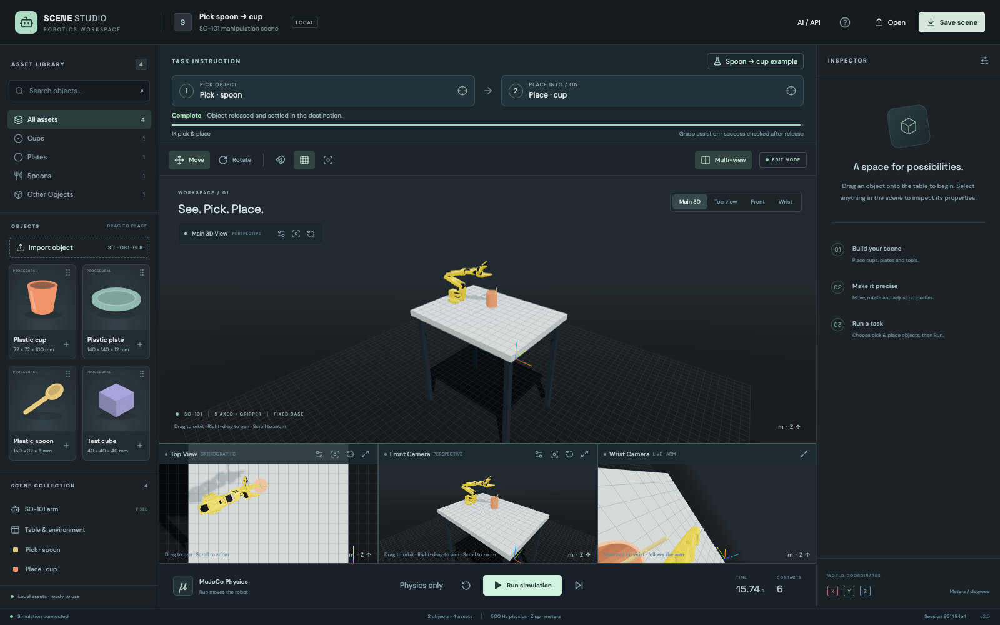

# SO-101 Scene Studio

A local 3D manipulation workbench with **real MuJoCo physics**, an **SO-101 arm**, five camera views, portable mesh import, researched **IKEA KALAS assets**, and **thirteen rehearsed pick/place examples**, and **MCP / HTTP control** of the scene you see in the browser.



## Start

Requires Node.js 22+ and Python 3.12, with `uv` or `pip`. On macOS/Linux:

```sh
bash scripts/setup.sh   # install or update pinned dependencies
bash scripts/start.sh
```

Open **http://127.0.0.1:5173**. First launch installs dependencies automatically if absent. After updating an existing installation, run setup again. Ctrl+C stops both servers. The launcher checks IPv4 ports 5173 / 8765 and never kills another app.

## Try the task

1. Choose a task from the **13-example menu** and click **Load example**.
2. Click **Calculate path**. The app rehearses the task in an isolated MuJoCo copy; your live scene stays still.
3. Inspect the **rainbow gripper path**, then click **Run simulation**. The arm approaches, closes, lifts, transfers, lowers, releases and retreats.
4. **Complete** appears after measured lift, release and settling. Examples take about 18 simulated seconds. Pause/Run resumes the active task; physical edits require a new calculation.

Calculation also works with user-arranged objects. Tests include moved destinations and spoon rotations of 0°, 45°, 90° and 270°. Unreachable or obstructed arrangements show a failure instead of enabling Run. This is a bounded rehearsal search, not a guarantee for every placement. Calculation can be cancelled; camera changes preserve a valid plan.

The controller uses numerical IK and **physical jaw contact/friction only**. There is no grasp weld, hidden attachment or object teleportation. Both jaws must sustain opposing forces before lifting; contact loss fails the task and lets gravity act. The UI shows measured left/right grip forces. Delivery is recalculated after lifting, and success requires release, actual destination support and settling. The original eleven examples were audited at every 1 ms step; see the [whole-arm safety audit](docs/physics/WHOLE-ARM-SAFETY.md) and [example 06 contact audit/video](docs/PHYSICS-AUDIT.md). This is not hardware-calibrated contact dynamics or a guarantee for arbitrary scenes.

## Build your own task

Click **Pick object**, then click the object directly in a viewport or the scene collection. Next click the destination. **Calculate path first, then Run simulation / Space moves the arm**; Pause freezes execution, Run resumes, Stop releases and cancels. Invalid or unreachable tasks show an actionable error. Cups, bowls, plates and solid supports can be destinations; the thirteen bundled arrangements cover cup insertion, bowl/plate placement and surrounding objects. Bring objects closer to the arm if IK cannot reach them. Imported hollow vessels use solid collision; use the procedural cup for insertion.

**Physics only** runs physics without a pick/place policy and opens the gripper. **Step** advances 20 ms while paused. While a task is paused, Step also advances its controller. Editing physical scene properties cancels the current task, recompiles and resets time/velocities. Changing only pick/place instructions preserves the measured physical state. Saved poses use measured joints, not unreachable actuator targets.

## Cameras and editing

Select **Table & environment → Tabletop color** to change the tabletop appearance. Its original light color is the default; the color is saved with the scene and used in browser and native camera images.

- **Main**, **Top**, **Front**, **Back**, **Wrist** tabs expand a view. Multi-view shows all five; narrow windows show front/wrist previews and keep Top and Back available as tabs.
- Front camera defaults to a front oblique/downward angle. Its settings button edits position, look-at target and field of view. Back defaults above the robot base, angled down toward the tabletop; it has the same editable settings and reset controls. Only Main supports orbit/pan/zoom. Top is orthographic and zoom-only, with the default robot base side at the bottom. Front/Back are fixed at their setup; use Edit camera to change them. Apply and Reset save camera setup in browser storage across restarts, independently of temporary Main navigation. Wrist follows the actual model-mounted `wrist_cam` pose and field of view.
- The compact asset category selector and search leave more room for Objects. Drag asset cards into a view or use +. During dragging a translucent object shows the exact clamped drop position before release. **Import object** accepts STL, OBJ and self-contained GLB from your computer, with explicit longest-side sizing. The mesh is centered and embedded in saved scenes, with editable color and **convex hull collision**. Limits: 10 MB upload, 20k vertices/40k triangles; textures and external sidecar files are not imported.
- Click empty tabletop/background to see the current object list in **Inspector**. Clicking a row selects the same object and axes as the viewport. Selection and task-source/destination buttons briefly highlight the object in every view.
- **Arrow keys** move the selected object on world X/Y by 1 cm; **Shift + arrows** uses 1 mm. Footprints stay within the tabletop; typing in fields is unaffected.
- Select an object for move/rotate gizmos, exact pose, scale, mass, friction, collision and color. **T/R**, **F**, **Delete**, **Cmd/Ctrl+S** shortcuts are available. Snap uses 1 cm / 15° increments.
- Select the arm for five arm joint targets plus gripper, or base pose. Select the table to resize it. All coordinates use meters, Z up, WXYZ quaternions; UI angles are degrees.
- **Save scene** downloads portable JSON including current poses, task and cameras. **Open** validates atomically; malformed files leave the current scene intact. Old version-1 files still load with new defaults. Max scene/message size 8 MB, 64 objects. A cumulative size budget rejects oversized additions before they can make your saved scene impossible to reopen.
- **Reset scene** empties the table while preserving cameras. Camera preferences also survive refresh in local storage. Refresh opens a new empty session; save your scene explicitly. A transient disconnect reconnects to the same session; its controller may continue while disconnected. If the server restarted, the browser restores its last acknowledged scene paused. Failed restoration leaves a downloadable recovery copy.
- At narrow widths, **Objects** and **Inspector** toggle side panels.

## IKEA KALAS assets

Defaults include bowl **603.786.69**, handleless cup **403.786.70**, spoon **204.406.54** and plate **203.786.71**. Official published dimensions are bowl Ø120 mm, spoon length 160 mm, plate Ø190 mm and cup capacity 230 mL. Heights, wall thicknesses, detailed profiles and physical properties are documented estimates. These are independently authored reconstructions, not manufacturer CAD. Open compound collision shells preserve container cavities; the visible spoon head is concave.

Existing model listings were researched, but no redistributable four-item set was verified. No paid/restricted meshes were bundled. See **[sources and dimensional confidence](docs/KALAS-SOURCES.md)**. Legacy plastic assets remain available so old files keep their original geometry.

## AI agents and external programs

Click **AI / API** or the session ID in the footer. Every browser scene has an explicit ID. An agent can list sessions, control that exact scene, read measured state, import meshes, change all object/robot/table/camera settings, execute tasks and obtain **native MuJoCo camera PNGs**. Independent headless sessions are also supported.

```sh
# Print ready-to-copy MCP client configuration, including absolute paths:
.venv/bin/python scripts/mcp-config.py
# MCP stdio entry point (editor service must already be running):
bash scripts/mcp.sh
# Run example in a new headless session; add an ID to use an existing scene:
.venv/bin/python examples/run_task.py
```

The bridge uses the official MCP Python SDK (v2), not a custom protocol. It connects only to the local service. Full endpoint/tool schemas, session lifecycle, concurrency and example commands: **[docs/API.md](docs/API.md)**. Interactive HTTP documentation: **http://127.0.0.1:8765/docs**.

## Verify

```sh
bash scripts/check.sh
# With the app running (uses installed Chrome by default):
cd frontend && npm run test:e2e
# Or: npx playwright install chromium && PLAYWRIGHT_CHROMIUM=1 npm run test:e2e
```

See **[docs/VERIFICATION.md](docs/VERIFICATION.md)** for current evidence and limits. Tests cover physical manipulation, repeated/perturbed placements, cancellation, camera poses/images, real STL/OBJ/GLB import, real MCP handshake/tools, shared API/browser control, direct scene clicks, five views, responsive layout and existing editing/recovery workflows.

## Model and system limits

Robot model: [MuJoCo Menagerie SO-101 provenance and Apache-2.0 license](assets/PROVENANCE.md). Household assets are procedural approximations. Physics runs at 1000 Hz and streams roughly 30 Hz, subject to machine load; highly detailed/high-contact scenes may run slower. WebGL is required for the editor. Agent PNG observations need native OpenGL; if unavailable, the API returns an explicit 503 while browser views remain usable. Native and browser lighting differ.

Local single-user service, no authentication or hardware connection. Bind only to loopback; HTTP and WebSocket origins/hosts are checked. Models are serialized per session. Up to 16 concurrent sessions; inactive browser-only sessions may be reclaimed to make room. Explicit API-created sessions remain until deletion or 30 minutes idle (reclaimed on creation). Exported scenes contain no server filesystem paths. Physics pauses before an object center escapes ±5 m.

The object library now offers the four IKEA KALAS reconstructions and a cube; old saved scenes still load their legacy asset definitions. Placement uses pointer capture, so only the translucent object appears on the tabletop—no browser drag-card image. Escape, cancellation or release outside a viewport cancels placement.

Example **11 · Spoon from cup onto plate** starts with a physically resting spoon in a cup. The controller grasps its exposed handle, clears the cup rim, and places it on a separate plate. It is also tested with a consecutive return task, picking that settled spoon back into the original cup. Whole-arm checks include the wrist camera, self-contact, table/objects, joint limits, waypoint tracking and the complete retreat. [Contact audit](docs/physics/example11-extraction.json) · [native video](docs/screenshots/example11-extraction.mp4).

### Robot reset position

Select **SCENE COLLECTION → SO-101 arm**, adjust **Joint positions**, then click **Save current pose as reset**. **Reset scene** and **Load example** start from that saved pose. **Apply saved pose** previews it in the current scene; **Use folded default** restores and saves the compact folded pose. The saved angles travel with scene files and are remembered for new workspaces in the same browser profile. Existing sessions and imported scenes keep their own settings.

Front and Back cameras have only their setup editor and expand control; their Reset camera buttons have been removed. Main and Top retain their reset controls.

### Cup rim grasp and loose contents

Example **12 · Cup by rim onto plate** pinches the cup wall near its rim, rather than attempting to span the full diameter. Example **13 · Cup with spoon onto plate** starts with a physically resting spoon in the cup; the spoon remains a free body throughout transport. The planner rehearses six rim directions with the same whole-arm checks and real actuator/contact limits as execution. It refuses a path if the cup or contents cannot be carried and settled safely.

For a consecutive task, place a spoon at `[-0.07, -0.015, 0.756]` with yaw 180° in example 12. Select **spoon → cup**, calculate and run; after completion select **cup → plate**, calculate again and run. The regression uses the measured state of the first task without resetting or repositioning either object. Contents must remain inside the cup and have real contact support at completion. The supplied cup geometry and friction are estimates, not calibrated hardware measurements. See [cup grasp validation](docs/physics/CUP-RIM-GRASP.md).

## Appearance Studio & dataset diversity

Open **Appearance** in the header. Choose a preset or adjust **Surfaces**, **World**, and **Light**, then **Apply appearance**. The six presets cover a neutral studio, daylight lab, warm workshop, industrial bay, color lab and terrazzo room. Eight procedural patterns (solid, checker, stripes, dots, wood, terrazzo, tiles, noise) support separate colors, repeat scale and finish. Robot body and motor colors are independent. Five environment layouts add visual-only walls, windows, shelves or panels outside the tabletop. Light color, direction, intensity, fill, ambient and shadows are configurable.

**Randomize** provides a seed, mild/balanced/wide ranges and independent robot, table, environment, lighting and object-color scopes. Unchecked scopes retain their settings. The same seed, scopes, range and input scene reproduce the same result with generator version 1. Manual edits clear the seed annotation; the saved complete scene is the authoritative recipe. Existing scenes load with default appearance. Reset and example loading retain the environment and tabletop appearance. Appearance commands require a paused simulation and retain measured poses, velocities, controls, time and prepared paths.

**Export recipes** downloads 1–32 full scenes for consecutive seeds (up to 32 MB per batch). These are configurations, not a recorded dataset. Use **Collect** to record complete demonstrations, or load individual `scenes[i]` through the `load` command. Save the recipe with each episode. Use held-out seeds and environment families for evaluation; variation alone does not demonstrate robustness. Camera, object placement, dynamics, sensor noise and real-world evaluation are separate dimensions to address in a collection pipeline.

Both renderers use the same generated texture pixels, colors, environment geometry and light configuration. Three.js uses metallic/roughness shading and box-projected UVs for robot meshes; MuJoCo uses specular/shininess and its generated texture coordinates. Shading and texture projection are approximate across renderers, not pixel-identical. Native observations contain no editor grids or selection overlays. No external texture downloads are required.

## LeRobot data collection

Open **Collect** to record five synchronized native cameras, measured joints, commanded actions and dense 1000 Hz trajectories. Select allowed color palettes (robot orange/yellow, table white/gray/black by default), patterns, environments and lighting; each episode receives a reproducible seed. A background copy rehearses and repeats the selected pick/place task while the editor remains usable.

Install once with `bash scripts/setup-collection.sh`. Finished jobs include a verified **LeRobot v3.0** dataset, H.264 videos, Parquet data, full episode recipes and NPZ trajectories. Download the ZIP from **Collect → Datasets**. Outputs stay local under `recordings/`. See **[setup, data contract, replay semantics and API](docs/DATA-COLLECTION.md)**.
