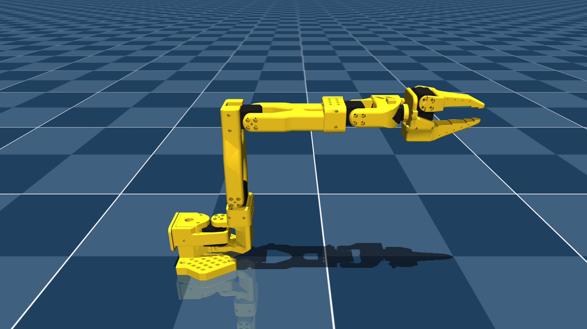

# The Robot Studio SO101 Description (MJCF)

> [!IMPORTANT]
> Requires MuJoCo 3.1.3 or later.

## Changelog

See [CHANGELOG.md](./CHANGELOG.md) for a full history of changes.

## Overview

This package contains a robot description (MJCF) of the [The Robot Studio SO101 robot](https://github.com/TheRobotStudio/SO-ARM100/tree/main/Simulation/SO101) developed by [I2
RT Robotics]. It is derived from the [publicly available
MJCF](https://github.com/TheRobotStudio/SO-ARM100/blob/608122e9ac330a753735f2e18aee73338e9ac407/Simulation/SO101/so101_new_calib.xml#L1).

  

## MJCF derivation steps

1. Copied `so101_new_calib.xml` (commit SHA aec17bbc256d1a7342d53aaa4950595d4c30b40d).
2. Rounded floats and reformatted the XML for readability.
3. Switched to implicitfast.
4. Use default `forcerange` for actuators rather than 3.35 N/m.
5. Added primitive collision geometries for the gripper and arm.
6. Add default collision solver parameters for the gripper that work well for manipulation.
7. Add a camera mount.

## License

This model is released under the [Apache License 2.0](LICENSE).

## Connection viewer URDF

`so101.urdf` is a visual/kinematic export of this package's `so101.xml`,
including the original CAD meshes, six joint frames, gripper, and wrist camera
mount. It uses the same Z-up base frame and calibrated joint radians as Gym.
It is generated by `scripts/export_robot_urdf.py`; regenerate after model edits.
The URDF is for display, not hardware control or a replacement physics model
(the placeholder velocity limit is zero). Collision and dynamics remain in MuJoCo.

The connection viewer follows the full-mesh approach used by Hybridge-VLA,
but loads an actual URDF through `urdf-loader` instead of maintaining a second
hard-coded joint chain. Unlike Hybridge-VLA's dataset display, the gripper
feedback is already radians and needs no 0–100 conversion.

`frontend/public/robots/so101` links to this directory so development and built
frontend distributions use the same assets without duplicate source meshes.
The existing Apache-2.0 license applies to this derived description and assets.
