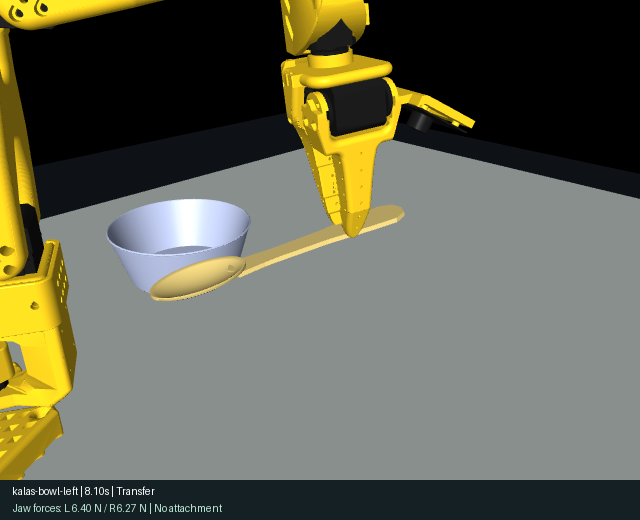

# Contact physics audit — v3.1

2026-10-24 · MuJoCo 3.17.0 · Apple Silicon · original example positions retained.

## What was wrong

The user was correct: example 06 could carry a spoon after losing jaw contact. The previous controller enabled a soft equality weld using only proximity and gripper angle, then left it active until release. It did not require opposing jaw forces or detect loss of contact. The old tests proved lift and final placement, not physically supported grasping. Their success results must not be interpreted as contact-only validation.

An audit of the original `459755d` implementation found example 06 held with neither jaw applying force for 3.064 s; example 05 for 1.546 s; example 08 for 1.044 s. See [original per-example evidence](physics/assisted-baseline.json).

## Corrections

- Removed grasp equality construction and activation. The controller only writes actuator targets; no object pose animation, external holding force, invisible collision pads or boosted friction.
- Settle objects first, measure their current pose, orient the jaw across the spoon handle and target the actual pinch location. Pre-close above the table so the moving jaw can clear it. The original open-hand reference was about 13 mm away from the narrow-handle pinch centre.
- Use 1 ms integration and 4 ms contact reference time with the existing elliptic friction cone. Limit gripper effort to 0.5 Nm, below the original 2.94 Nm servo stall limit. Source robot meshes, masses, friction coefficients and arm force limits stay unchanged.
- Require at least 80 ms of opposing source contacts, each over 0.02 N, with penetration below 1.5 mm before lifting. Continue monitoring while carrying. A contact loss exceeding 100 ms fails the task, opens the jaws and runs passive physics for 1.5 s so the object falls visibly. Numerical/workspace guards still pause immediately.
- Recompute delivery from the measured grasp after lifting. Release over bowl/plate rims rather than driving the hand toward the container floor. Cup insertion still aims the spoon head downward.
- Success requires actual destination contact, no remaining jaw support, measured lift, an upright destination, correct containment, linear speed below 0.03 m/s and angular speed below 0.3 rad/s. A geometrically contained but unsupported spoon cannot count as settled.
- UI/API report contact-only mode and measured left/right normal forces. Browser Step remains 20 ms; API default 10 integration steps is now 10 ms.

The solver changes follow MuJoCo’s guidance to inspect contact forces, resolve thin contacts with appropriate integration/contact settings, and distinguish physical slip from numerical slip: [official modeling guide](https://mujoco.readthedocs.io/en/stable/modeling.html#preventing-slip). They do not establish real-world material calibration.

## Every-step physical audit

Each unchanged example was rehearsed, then executed independently while examining every 1 ms integration step. The following interval is the longest absence of a **secure bilateral grip** while carrying; the new check is stricter than the original neither-jaw-contact baseline. Every case had 6602/6602 secure carrying samples and no active equality constraints.

| Example | Result | Lift | Minimum jaw force | Maximum jaw penetration | Unsupported carry |
|---|---|---:|---:|---:|---:|
| kalas-cup-front | PASS | 216.8 mm | 4.55 N | 0.513 mm | 0.000 s |
| kalas-cup-left | PASS | 216.9 mm | 4.50 N | 0.517 mm | 0.000 s |
| kalas-cup-right | PASS | 216.7 mm | 4.46 N | 0.653 mm | 0.000 s |
| kalas-cup-near | PASS | 217.0 mm | 5.58 N | 0.482 mm | 0.000 s |
| kalas-bowl-front | PASS | 181.0 mm | 4.45 N | 0.503 mm | 0.000 s |
| kalas-bowl-left | PASS | 181.6 mm | 4.46 N | 0.499 mm | 0.000 s |
| kalas-plate-front | PASS | 160.8 mm | 4.30 N | 0.498 mm | 0.000 s |
| kalas-plate-angle | PASS | 133.2 mm | 4.54 N | 0.665 mm | 0.000 s |
| kalas-cup-clutter | PASS | 216.8 mm | 4.55 N | 0.513 mm | 0.000 s |
| kalas-bowl-clutter | PASS | 179.4 mm | 4.30 N | 0.500 mm | 0.000 s |

All completed in 17.907 simulated seconds. Example08 used the lower-lift candidate; the others used the first candidate. [Full measurements and phase records](physics/contact-audit.json).

## Visual evidence

[Example06 close-up video](screenshots/example06-contact-physics.mp4) records native MuJoCo rendering from the actual physics execution, with measured jaw forces. It contains no pose animation.



## Reproduce

```sh
.venv/bin/python scripts/audit_physics.py --output /tmp/contact-audit.json
.venv/bin/python scripts/audit_physics.py --example kalas-bowl-left --output /tmp/example06.json --video /tmp/example06.mp4
bash scripts/check.sh
(cd frontend && npm run test:e2e)
```

The optional video requires ffmpeg. The audit without video uses the installed project dependencies.

## Scope and limits

This replaces the assisted grasp with contact-only dynamics; it is still a rigid-body simulation with soft contact constraints. Measured jaw overlap peaks at approximately 0.5–0.7 mm in these cases. KALAS masses, friction, wall thickness and some dimensions remain estimates. The robot collision meshes approximate the visible printed parts; plastic compliance, actuator calibration and hardware grasp reliability need physical measurements. Bounded IK candidates can reject otherwise possible arrangements. Wide objects or a non-flat utensil may need a different grasp strategy. Imported meshes still use convex collision.

Open scenes were backed up locally in scene-backups/ before restarting the service, and their poses/cameras were restored. These private backups are ignored by Git. Existing calculated paths must be recalculated with the new dynamics.

Final automated-suite and independent-review results are recorded in [VERIFICATION.md](VERIFICATION.md).
