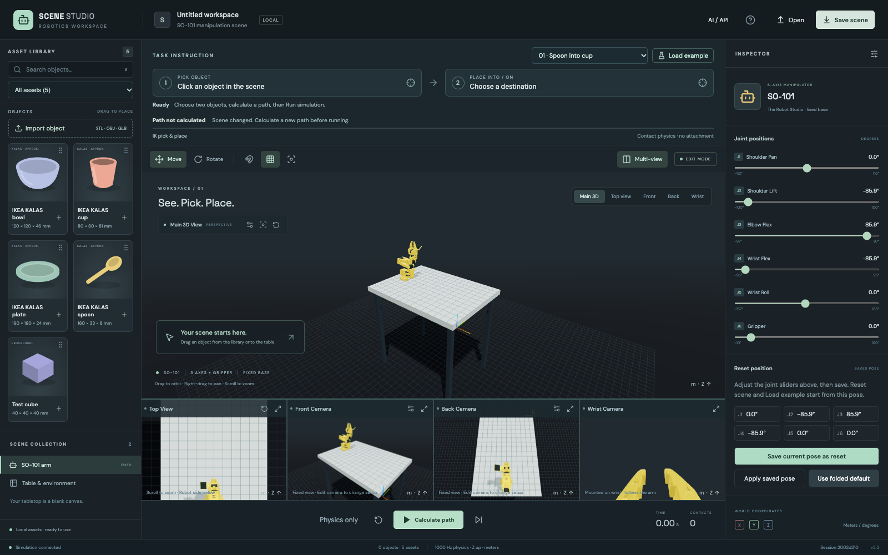
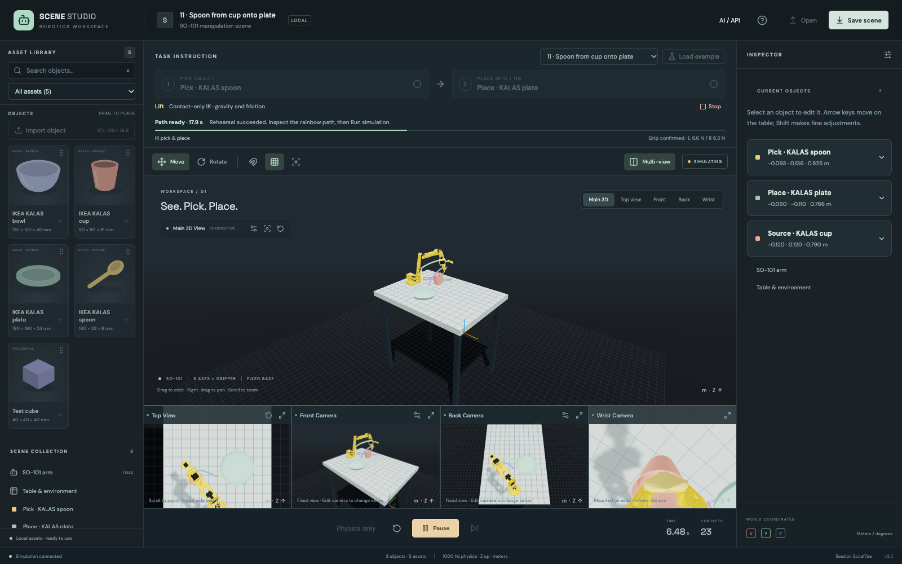
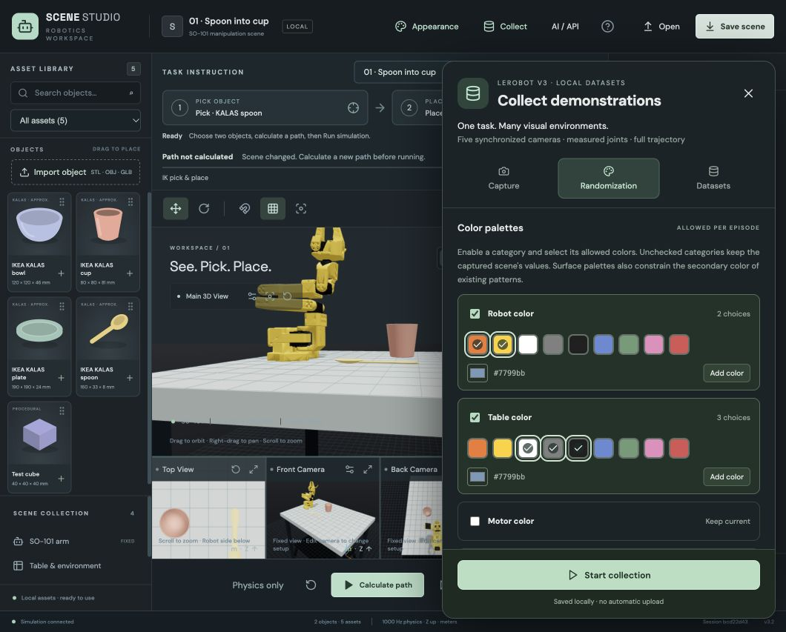

# Verification — contact-only physics v3.1

2026-10-24 · MuJoCo 3.17.0 · macOS Apple Silicon · Python 3.12.

- **90 backend tests passed** in 161.57 seconds. This includes each of the ten original arrangements executed with 1-, 17- and 33-step observation batches, custom yaw angles, a changed robot base, unreachable/blocked scenes, legacy spoon variations, scene import/export, HTTP/WebSocket and real MCP integration.
- **13 frontend unit tests passed**, strict TypeScript and production build passed. The existing large 3D bundle warning remains (~1.24 MB before gzip).
- **22 browser scenarios passed** in 1.8 minutes. Example06 specifically verifies measured opposing forces in the UI/API, contact-only mode and released completion. Existing placement, arrows, camera, import, persistence and reconnect flows also pass.
- **125 automated tests total**, plus an independent every-1-ms physical audit of all ten examples. Every case succeeded with 6,602/6,602 secure carrying samples, no active attachment constraint and 0 ms unsupported carrying time.
- Native close-up video and frames were inspected for examples01,06,08 (cup, bowl, plate). See [detailed root cause, measurements, source documentation and video](PHYSICS-AUDIT.md).

## Regression evidence

The original three regressions failed against assisted physics: invisible constraint during carrying, opening the gripper without the object falling, and proximity without contact accepted as a grasp. They now pass. A separate regression catches geometric containment without destination support (observed RED then GREEN). A loss-of-contact test also proves that failure allows passive falling instead of freezing mid-air; reverting that behavior made the test fail before restoration passed. Existing workspace-boundary tests caught the distinction between normal grasp failure and a numerical/workspace guard; guards still pause immediately.

The previous fixed-step-duration tests were updated to retain their original simulated time budgets after the integration step changed from 2 ms to 1 ms. Success/contact thresholds were strengthened, not relaxed. Original example positions, source meshes, object masses, friction and arm actuator force limits were retained. Gripper effort is reduced from the source model's 2.94 Nm limit to 0.5 Nm.

## Decisions and limitations

- The user's realism requirement supersedes assisted-mode behavior. There is no weld option. Previously successful assisted scenes may correctly fail physical grasp validation.
- Work stays on a dedicated branch in the existing checkout; coupled controller/session/UI changes are implemented inline, with one independent final review. This preserves the local app path; it provides less filesystem isolation than a separate checkout.
- The planner tries bounded physical candidates and can reject solvable scenes. It does not guarantee arbitrary placement success.
- A dropped grasp leaves passive physics running for 1.5 seconds; explicit Pause/Stop and numerical guards still freeze the scene. Stop queues a physical jaw opening; physics or Step must advance it.
- Contacts remain a soft rigid-body approximation; peak measured jaw overlap is about 0.5–0.7 mm. KALAS dimensions/material properties and hardware calibration remain the limits documented in [KALAS-SOURCES.md](KALAS-SOURCES.md).
- Local open scenes were backed up in ignored scene-backups/ folders and restored across the service update. Their positions/cameras remain; physics time and old plans reset. No private backups are pushed.

The earlier assisted-mode report is retained as [historical evidence](VERIFICATION-V3-ASSISTED.md), not current physical-grasp validation.

## Independent review and fixes

One independent whole-branch review found no critical issues and independently passed 41 focused physical tests. It found one important issue: measured grip telemetry stayed cached after cancellation or failure while passive physics moved the object. Both cases were reproduced with failing regressions. Packets now measure the completed physics state regardless of controller status; both regressions and all seven contact regressions pass. The minor video-command quoting issue was also corrected. No review findings were deferred. After these fixes, the complete 90-test backend suite passed again and the example06 browser scenario passed again (23.0 seconds). The first browser rerun encountered the 16-session capacity limit; closing a backed-up empty test session resolved the environment issue without product changes.

The review validated the removal of attachment constraints, selected-source/opposing-jaw contact checks, passive falling and physical destination support. It declined to certify hardware calibration, universal arbitrary-scene success, imported concave meshes or public hosting. These remain the documented scope limits, not claims of this fix. Stop intentionally pauses physics and queues jaw opening for the next Step/Physics command.

## Library layout and native drag correction

2026-10-24: At 1512 × 800 the asset grid compressed four rows to approximately 29 px each while their artwork/labels needed 163 px. Content-sized grid rows now retain complete cards and overflow scrolls within the library. An explicit transparent native drag image suppresses the browser's card/control snapshot; the existing tabletop object preview remains.

Three new browser regressions first failed and then passed: complete card contents at 1512 × 800 and 1280 × 720, and a real native mouse drag that supplies no visible drag image and still places the selected object. The complete browser run passed 22 cases and exposed three pre-existing synthetic-event/render-readiness races; those tests now wait for canvas layout, tolerate an initially absent canvas, use a real mouse drop or repeat dragover as native dragging does. All three then passed together (6.4 s), covering all 25 browser scenarios across these runs. Frontend unit tests (13), TypeScript and production build passed; the existing bundle-size warning remains. Backend physics was unchanged.

Browser checks used isolated ports 5174/8766 because the user's live server was at its session limit. Live scenes were not reset. [Inspected library screenshot](screenshots/library-complete.png).

## v3.2 — Pointer-only placement and cup extraction

The previous transparent native drag image was insufficient on the user's browser. Library gestures now use pointer capture and explicitly disable native drag start; there is no native drag image to snapshot. Only the translucent object is rendered over the table, with no drag label/card. Escape, pointer cancellation, window blur, outside/control release and disabled editing cancel placement. The library and counters show four IKEA KALAS assets plus cube; legacy assets remain available to old scenes and API clients.

- **94 backend tests passed** in 188.68 s, including all eleven examples rehearsed then independently executed at 1/17/33-step observation batches.
- **26 browser scenarios passed**: full 24-case suite (1.7 min), plus example11 through Calculate path/Run/release (25.3 s), plus viewport activation after drop. All three pointer scenarios passed again after final polish (6.1 s).
- **13 frontend unit tests**, strict TypeScript and production build passed. Existing bundle-size warning remains.
- Total: **133 distinct automated cases**. Tests use isolated servers; user scenes are preserved.

Example11 starts from a measured resting spoon pose inside the cup. Upright-handle IK constrains position and pinch direction while allowing wrist tilt, rather than overconstraining the five-axis arm. Physical opposing contact remains mandatory. Regression checks verify initial spoon/cup contact, spoon clearance above the rim before Transfer, cup displacement below 2 cm and cup uprightness, then released destination support. The original ten tasks retain their full-pose grasp method.

The independent 1 ms audit of example11 succeeded in 17.907 simulated seconds, with 6,602/6,602 secure carrying samples, zero unsupported time, minimum jaw force 3.56 N and maximum jaw overlap 0.347 mm. No attachment constraint is present. Native initial/grasp/lift/release frames were inspected. [Raw audit](physics/example11-extraction.json) · [video](screenshots/example11-extraction.mp4) · [initial scene](screenshots/example11-initial.png) · [pointer placement](screenshots/pointer-only-placement.png).

Implementation decision: keep legacy asset definitions/API entries for saved-scene compatibility; curate only the editor library. These remain approximate rigid-body materials/geometry, and bounded IK can reject arbitrary arrangements. Independent final review found no critical or important issues and independently passed 28 focused backend checks and two pointer browser scenarios. It found one minor regression: a drop into another viewport did not activate that camera. A new browser regression reproduced the failure, then passed after restoring activation before placement. No findings remain deferred. Final visual polish removes the preview axes, rim and floor guides, leaving only the translucent object; the screenshot was refreshed and inspected. Frontend unit tests, TypeScript and production build passed again after these changes. Review did not certify hardware calibration or guaranteed success for arbitrary arrangements.

## Back camera

Added an independent editable Back view to the main view selector and desktop multi-view strip. The default position is `[-0.30, 0, 1.65]`, looking at `[0, 0, 0.80]` with 55° field of view: approximately 90 cm above the default robot base. It supports orbit, pan, zoom, reset, scene persistence, HTTP camera commands and native image rendering, and MCP camera commands/images. Older scene files and saved camera preferences receive an additive Back default. Narrow layouts retain Front/Wrist previews and make Back available through its tab.

The API regression first failed with HTTP 422 for Back, then passed. Browser coverage exercises editing, refresh, reset, native PNG rendering, narrow-screen controls and importing a legacy camera map. An initial browser assertion used exact floating-point equality after OrbitControls; it now uses numerical tolerance. Existing canvas-count assertions were updated from four to five. Inspected Back at 1600×1000 and the four-preview strip at 1280×800. All eight live scenes were backed up and restored with their existing object positions and cameras intact; plans require recalculation after the service restart.

Verification: **95 backend tests passed** (192.05 s), **13 frontend unit tests**, TypeScript and production build passed. All **27 browser scenarios** passed across the full run and targeted reruns: the initial run passed 21 and failed six obsolete four-canvas assertions; after updating those assertions for five views, the editor rerun passed eight, and the remaining recovery test passed separately after updating its timeout-specific assertion. **135 distinct automated cases** in total. The existing bundle-size warning remains.

A separate real MCP handshake also returned the Back camera as native PNG. [Inspected Back view](screenshots/back-camera.png).

## Fixed camera controls, tabletop color and compact library

Only Main supports orbit/pan and frame-selection shortcuts. Top is zoom-only with +X screen-up, putting the default robot/base side at the bottom. Front/Back apply exact saved poses without OrbitControls; Wrist remains mounted to the robot. Explicit Apply/Reset setup is stored separately from transient navigation state and survives closing/relaunching the browser profile. Existing/reconnecting sessions and opened scene files retain their own cameras; saved setup initializes new workspaces.

Tabletop color is validated in the scene schema, applied to native geometry and saved in scene documents; default #b8c2bf preserves the original light appearance. Legs/contact properties are unchanged. The category list is now a compact selector, and the MuJoCo label has been removed from the simulation toolbar. [Inspected workspace](screenshots/workspace-settings.png) · [native Top orientation](screenshots/top-fixed-native.png).

The camera-lock regression first reproduced Front moving after drag/wheel/F, then passed after fixed controls. Lower-screen Top placement verifies negative world X, and right/left drag plus F leave Top unchanged while wheel zoom works. A persistent Chromium profile is actually closed and relaunched to verify Apply survives; refreshing an unrelated camera cache cannot overwrite the saved setup. Table color roundtrips through Save/Open and old scenes receive the light default. Original gizmo/drop/scene-click tests now use the new Top projection, preserving their physical assertions.

One independent review found the native Top azimuth reversed relative to the browser. A PNG-based regression reproduced the robot above center, then passed after correcting azimuth to 0. The corrected native screenshot was inspected. The minor hardcoded Chrome test option was changed to honor PLAYWRIGHT_CHROMIUM. No findings remain deferred. Browser storage denial remains an in-memory fallback; persistence is scoped to the same browser profile/origin. Physics/material calibration is unchanged.

Verification: **96 backend tests passed** (182.16 s), then both native-render checks passed (3.02 s), covering **97 distinct backend cases**. **30 browser scenarios passed** in 2.4 minutes; **13 frontend unit tests**, TypeScript, production build and focused lint passed. **140 distinct automated cases** total. Nine live scenes were backed up/restored and their object positions and camera values verified unchanged. The existing large-bundle warning remains.

## Saved reset position and fixed-camera controls (2026-10-24)

The SO-101 inspector now saves a six-joint reset pose, applies the saved pose, or restores the compact folded default. Reset scene and all eleven example loaders use the saved angles. The scene schema validates both current and reset joints against the actual model ranges before swapping state. Legacy files preserve their current pose and receive the folded reset default. Explicit saves persist in browser storage after the server acknowledges them; existing scenes take precedence over browser preferences.

- Backend: **101 tests passed** (206.10 s), including all eleven examples at 1/17/33-step batches, physical grip/release checks, saved-pose reset/example/serialization tests, atomic rejection and legacy migration.
- Frontend unit tests: **13 passed**. Production build passed; the existing large-bundle warning remains. Python E/F checks excluding line length passed. The unrestricted lint profile also reports existing import-order/style findings; that broader style cleanup is outside this change.
- The folded default `[0, -1.5, 1.5, -1.5, 0, 0]` stays contact-free over two simulated seconds, with joint drift under 0.002 rad. An additional every-1-ms audit of the first four seconds of all eleven example policies found **zero robot self-contact penetration** while unfolding.
- Browser suite: **31 scenarios passed** (2.5 minutes); **145 automated tests total**. The new browser regression verifies save, reset, example loading, scene reconnect with a conflicting browser preference, a fresh browser context, and restoring the folded default. The final expanded regression also passed independently (8.4 seconds). Front/Back no longer expose Reset camera. Existing Main/Top controls remain.
- Independent read-only review found no actionable defects. Its suggested conflicting-preference regression was added and passed.
- The local service was updated after backing up all eleven open sessions. Restored object data, camera settings and current joint targets matched the backups exactly; the additive reset setting uses the folded default. Backups remain ignored and are not published.

## Example 11 with a downward-wrist reset pose (2026-10-24)

The reported failure was reproduced from the actual failing session, which used saved joints `[0, -1.5, 1.5, 0.985937, 0, 0]`. At the original example coordinates, the wrist camera collision geometry already overlapped the source cup by **10.62 mm** before motion. All five rehearsal candidates failed during Settle at 0.01 s. Earlier default-pose tests did not cover this saved-pose combination.

The Example 11 preset now translates the source cup and its resting spoon together **30 mm along +Y**, preserving their relative resting transform. The saved robot pose, destination plate, collision shapes, friction, solver and contact-only grasp remain unchanged. Existing scene files keep their coordinates. A new preflight rejects deep initial robot overlaps before rehearsal and identifies the part, object and overlap depth, instead of reporting a generic path obstruction after five retries.

Four regressions were observed failing before the fix, then passed: physical extraction with the reported wrist angle and nearby 0.8/1.1 rad variants, plus non-mutating rejection of the original overlapping arrangement. Each successful run verifies the source cup ends within 5 mm of its initial position. Folded and legacy extended starting poses were also rehearsed successfully. The browser now includes a saved-downward-wrist Example 11 scenario, with measured opposing forces and released completion; its focused run passed in 25.4 s.

An independent every-1-ms execution audit of the reported reset pose completed in **17.907 simulated seconds**. All **6,602/6,602 carrying samples** had secure opposing contact; minimum opposing jaw force was **3.583 N**, unsupported carrying time **0 ms**, robot/source-cup penetration **0 mm**, maximum cup displacement **3.593 mm**, and active/model attachment constraints **zero**.

Read-only review found no actionable defects and independently verified that all eleven default presets pass the new overlap preflight. Arbitrary saved poses can still be invalid; the fix does not bypass collision rejection or promise success for every arrangement.

Verification for this fix: the full backend suite passed **105 tests** in 235.32 s; frontend unit tests passed **13**, and the production build and Python E/F checks passed. The expanded browser reproduction also checks the old-scene diagnostic before loading the corrected example and physically completing it (30.2 s). An initial full browser pass exposed an existing test race in `scene selection sets task and front camera is editable`: it clicked the destination before the source acknowledgement changed picking mode. The test now waits for the visible destination-selection state before its second click.

The service update preserved all fourteen open scenes exactly. The identified failed session was then corrected by translating only its cup/spoon pair 30 mm along +Y, after verifying its objects and robot settings still matched the captured failure. Its existing saved reset pose and cameras were retained; a live rehearsal now reports **Path ready**. The other sessions were not rearranged.

The final complete browser rerun passed **32/32 scenarios** in 3.0 minutes, including the old-overlap diagnostic followed by successful physical execution from the custom reset pose. Combined with 105 backend and 13 frontend unit tests, **150 automated tests passed** for the final implementation.

## Seeded LeRobot collection (2026-10-29)

The new **Collect** panel records main/top/front/back/wrist cameras with joint state, velocity, effort, TCP and actual commanded joint targets. Capture uses the same simulation state for all views. Dense 1000 Hz NPZ trajectories retain every controller command; sampled actions are instantaneous targets, not commands held for a complete video interval. Official LeRobot 0.6.1 creates v3.0 Parquet/H.264 datasets, and official reader/PyAV validation gates downloads. [Contract and setup](DATA-COLLECTION.md).

- Full backend suite: **158 passed** (514.65 s). A final rollback regression was then added; the final focused collection run passed **8 tests**, covering **159 distinct backend cases** together with the full run. Frontend: **14 unit tests**, TypeScript and production build passed. Existing Vite large-chunk warning remains. Python focused correctness lint and `git diff --check` passed.
- Browser suite: **38 passed**, with one pre-existing capacity assumption failing because an editor tab already occupied a session. The test now fills available capacity without deleting existing sessions. Final focused capacity/collection rerun: **2 passed** (13.1 s), covering **all 39 scenarios**. Collection waits for its own job, confirms exactly 10 retained frames, downloads its ZIP and compares the live scene/time before and after. Mobile close control remains visible at 390 px.
- Collection tests use the actual installed writer/reader, not file-name mocks: two 10-frame episodes; deterministic bounded palettes; preserved physical scene; exact sample-step state/action/time mapping; cooperative stop retaining prior episodes and cancellation provenance; invalid config/task/path rejection. Integration tests skip only when the optional collection runtime is absent.
- Independent review found and reproduced partially committed Parquet on video failure. The fix finalizes each episode and resumes into new shards, checkpointing metadata for rollback. An injected failure after the next episode's main video is saved now preserves the first episode and passes official readback. A separate persistent-finalization-error regression verifies rollback even when closing fails. Checkpoints survive a failed restoration. Secondary colors respect enabled palettes; cancelled/error attempts retain their seed and recipe. Final focused review found no actionable issues.
- Real successful demonstration: **2 episodes, seeds 42/43, 640×480 at 20 FPS**, **359 frames per episode / 718 per camera**, each task completing at **17.907 simulated seconds**. Robot colors were yellow then orange, tabletop gray, room layout with varied lighting. All five videos, full traces and sampled data verified; the 23-file ZIP is about 11.6 MB. First/middle native images were visually inspected, including the wrist view during motion. Outputs remain in ignored local recordings.

Hard process termination/power loss is not automatically recovered into a verified dataset. Randomization currently varies visual properties, retaining the physical task and camera setup. No learned-policy robustness claim is made.

