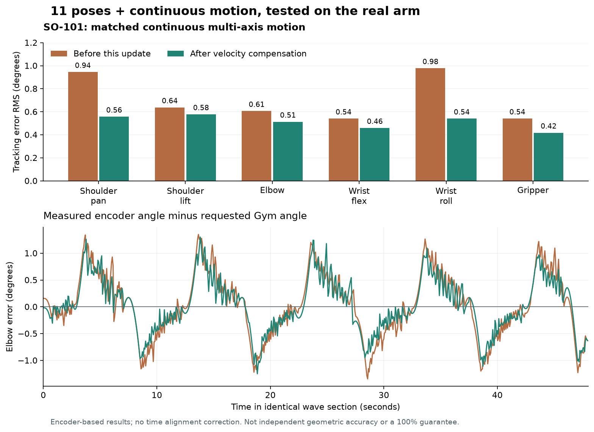

# Broad physical sync repeat — 2026-10-25

A repeatable 11-pose physical test passed before and after adding filtered velocity feedforward. The separate continuous multi-axis section improved RMS tracking error on all six axes. Some pose-transition measurements regressed slightly; this report includes them rather than claiming universal improvement or 100% agreement.

## Change and acceptance decision

The controller now adds 0.12 seconds × filtered reference velocity, with a 0.10-second filter time constant. It uses the rate-limited desired reference, not differentiated encoder readings. Existing proportional/integral gains, correction limits, speed/acceleration limits, calibration, collision/telemetry guards and motor EEPROM are unchanged. This targets the velocity-correlated lag seen in recorded movement; a velocity/error fit is not a direct measurement of network latency.

The independent loaded-servo regression failed at 0.007886 rad RMS before the change for a 0.22-second plant lag. Both 0.10/0.22-second lag cases pass the 0.005 rad requirement after the change. Existing reversal, saturation, stale-input and service tests also pass. Physical acceptance is based on the matched recordings below, not that simplified plant alone.

The tuning is retained because all six continuous-motion RMS measurements improved, with generally similar pose-transition and stationary performance. It is not uniformly better: pose-transition elbow RMS rose by approximately 0.05°, and the shoulder-lift transition peak rose by approximately 0.24°. These costs are explicit; unchanged bounds still limit commands.

## Physical runs and method

- Baseline: 11 poses, then 48 seconds of independent six-axis waves, followed by an 8-second stationary hold; 246.9 seconds, 3,656 samples, passed.
- Feedforward commissioning: the same wave section with startup/hold; 64 seconds, 944 samples, passed.
- Full feedforward repeat: the same 11 pose targets and wave section; 245.0 seconds, 3,579 samples, passed.
- Additional worst-pose check: a 54-second high-right/return trial with 12-second pose holds passed. During the last two seconds at high-right, elbow error was at most 0.130°; the larger four-second-hold error had continued settling. This extra trial does not replace the matched comparison.
- Stop/re-enable test: 3 seconds stopped, 4 seconds enabled holding, 8 seconds stationary sync; no encoder change observed and torque stayed on.

Each pose uses a quintic transition at a planned peak reference speed of at most 0.15 rad/s and a four-second hold. Transition duration is max(4 s, 1.875 × largest joint delta / 0.15). Startup pose differs between runs; the first center transition is excluded from the pose-transition comparison. Remaining pose targets and timing are identical. Wave periods are [9, 11, 10, 13, 8, 12] seconds, with amplitudes [0.22, 0.08, 0.10, 0.10, 0.22, 0.15] radians and three-second end envelopes. Exact centers, segments and timings are in [summary.json](broad-sync-2026-10-25/summary.json).

Offline whole-arm collision preflight passed before each physical run. Runtime checks remained active. Targets traveled through the Gym session API to the sole hardware owner; measurements came from the six physical encoders. The workspace scene had no objects and the arm carried no payload. A local camera snapshot showed only part of the arm/workspace and does not establish full optical clearance or independent angle accuracy.

RMS = sqrt(mean((measured − requested)²)), converted to degrees. HTTP measurements are asynchronous and include tracking delay; no time shifting or error smoothing is applied. The wave metric excludes the first/last three seconds of its 48-second section. The final stationary metric uses the last two seconds. No physical run in this repeat series faulted or was discarded.

## Continuous multi-axis comparison

| Joint | Before RMS ° | After RMS ° | Before peak ° | After peak ° |
| --- | ---: | ---: | ---: | ---: |
| Shoulder pan | 0.944 | 0.557 | 2.270 | 1.579 |
| Shoulder lift | 0.638 | 0.577 | 1.746 | 1.797 |
| Elbow flex | 0.606 | 0.513 | 1.350 | 1.302 |
| Wrist flex | 0.540 | 0.458 | 1.279 | 1.118 |
| Wrist roll | 0.977 | 0.540 | 2.293 | 1.649 |
| Gripper | 0.541 | 0.417 | 1.322 | 1.127 |

## Pose transitions, stationary checks and coverage

| Joint | Transition RMS before ° | Transition RMS after ° | Transition peak after ° | Final stationary RMS ° | Worst after four-second pose holds ° | Tested requested range after ° |
| --- | ---: | ---: | ---: | ---: | ---: | --- |
| Shoulder pan | 0.301 | 0.253 | 1.334 | 0.132 | 0.220 | -40.1 to 40.1 |
| Shoulder lift | 0.263 | 0.244 | 2.005 | 0.052 | 0.157 | -77.3 to -37.2 |
| Elbow flex | 0.160 | 0.208 | 1.375 | 0.018 | 0.393 | 14.3 to 68.8 |
| Wrist flex | 0.263 | 0.265 | 1.421 | 0.065 | 0.111 | -17.2 to 63.0 |
| Wrist roll | 0.306 | 0.313 | 1.253 | 0.077 | 0.177 | -126.1 to -17.2 |
| Gripper | 0.241 | 0.193 | 1.235 | 0.050 | 0.159 | 5.7 to 63.0 |

The largest settled pose error was elbow 0.393° at `high_right`, measured during the last second of its four-second hold. Final stationary errors at the center pose were at most 0.132°. These are different measurements and must not be interchanged. The baseline also included an initial pose at shoulder lift −82.2° and elbow 78.6°; this startup segment is not matched in the after-run.

This is a finite pose set inside the collision-checked working region, not every combination of joint angles or a sweep to all mechanical limits. Payloads, physical obstacles absent from the scene, joint-limit poses, cable limits and absolute geometric calibration are not established by these trials. The changed controller bounds commands in software; actual mechanical acceleration/jerk was not independently instrumented.

## Telemetry and operational checks

Maximum returned feedback age was 73.7 ms before and 83.3 ms after. These are observations, not hard realtime guarantees. The baseline had four temperature-confirmation events, commissioning one, and full repeat six. For example, one frame reported [83, 36, 36, 36]°C across the bounded confirmation sequence. The cause of these isolated temperature anomalies remains unresolved; the existing checked-frame confirmation and 65°C fault rules were not relaxed. Events are included in summary.json.

All 14 existing scene sessions were preserved during backend restart. Reconnection began with motion disabled and verified calibration restored. No new session, zero-offset change, motor EEPROM write or torque-off write was used. Streaming is stopped after verification, with torque retained.

## Verification and review

63 focused backend tests passed (tracking, driver, service, module integration and MCP), including the two new lag-response cases. Fatal Python lint and whitespace checks passed. Frontend sources did not change; the prior frontend build is not claimed as a fresh run. The unrelated manipulation-policy suite was not rerun.

Independent code review found no Critical/Important defects and independently passed all ten tracking tests. Minor deferred: add direct regression assertions for the new filtered reference-velocity state across both reset modes and stale rejection. Current reset/rejection code is correct, existing output-bound tests pass, and physical Stop/re-enable passed. This is a future test-coverage improvement, not a known motion defect.

## Evidence and accuracy limits

- [Baseline CSV](broad-sync-2026-10-25/baseline.csv)
- [Commissioning CSV](broad-sync-2026-10-25/feedforward-commission.csv)
- [Full repeat CSV](broad-sync-2026-10-25/feedforward-full.csv)
- [Profiles, metrics and temperature confirmations](broad-sync-2026-10-25/summary.json)
- [Extended high-pose dwell trace](broad-sync-2026-10-25/high-pose-dwell.json)
- [Stop/re-enable trace](broad-sync-2026-10-25/hold-restart.json)

Encoder quantization is 0.08789° per tick. Numerical error below one tick does not establish finer physical measurement accuracy. Backlash, link compliance, assembly offsets and camera extrinsics remain outside this encoder-based validation. Independent geometric measurement is needed to assess physical link angles or tool position. Exact 100% agreement has not been established.
