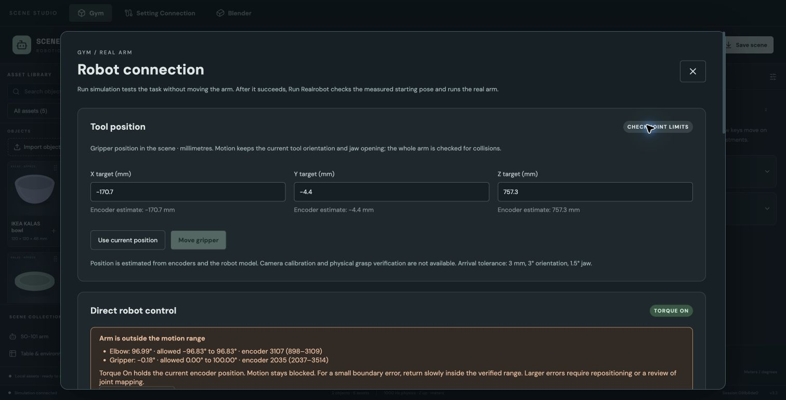

# Cartesian real-arm control — 2026-10-25

## Outcome and scope

Real control now targets the gripper tool frame independently of Gym joint angles and simulation time. All arm links, joint ranges, quantized motor commands, and estimated carried-object geometry remain checked. **Physical task completion remains blocked by the attached arm's motor response/range violations.** The new software does not establish absolute millimetre accuracy, successful physical grasp, or physical motion smoothness.

Position is forward kinematics from the encoders and configured robot/mount model. Arrival requires ≤3 mm, ≤3° orientation error, and ≤1.5° jaw error; six consecutive frames confirm final arrival. These are acceptance thresholds, not measured absolute hardware accuracy. Object positions used for collision checking are explicitly predictions from simulation, not independent observations.

## Software verification

Regression tests cover reachable/unreachable IK, whole-arm collision rejection, encoder rounding, jaw/orientation arrival, independent Gym state, scene changes, lease/epoch cancellation, and preserving a fresh measured hold. Two independent-review findings were reproduced with failing tests and fixed: Cartesian Stop no longer reuses compensation checked against the wrong scene; a joint command replaces the Cartesian controller instead of retaining its previous tool goal.

A third regression verifies continuity of predicted object geometry from the last measured endpoint. Release now waits for measured jaw opening before retreat, with a bounded failure timeout; finger contact during closing remains supported. Existing collision tolerances are unchanged.

The three integration examples run real MuJoCo rehearsal, IK and swept collision checks with an **ideal fake bus that jumps to each quantized target**. They test geometry/controller sequencing, not servo dynamics:

| Example | Tool waypoints reached | Final estimated position error |
|---|---:|---:|
| 01 · Spoon into front cup | 304 / 304 | 0.113 mm |
| 02 · Spoon into left cup | 304 / 304 | 0.252 mm |
| 03 · Spoon into right cup | 304 / 304 | 0.207 mm |

All three reports retain `object_verified=false`. Executable regression: `backend/tests/test_cartesian_rehearsal.py`. Detailed probe evidence: [JSON](2026-10-25-cartesian-evidence.json).

Final verification: `python -m pytest backend/tests -q` — **334 passed in 543.35 s**. After removing the obsolete shared-clock branch and unused fixture code, the affected session/control tests were rerun — **41 passed in 5.75 s**. Frontend: **27 tests passed** and production build succeeded (existing large Three.js chunk warning). New controller/test files passed unused/undefined-name checks; `git diff --check` passed.

## Physical probes — not a passed task

Six motor identities and telemetry were readable; torque was on and measured voltage approximately 12.2–12.4 V. Read-only deadband registers were 10 ticks in both directions. No EEPROM was written. Every bounded probe commanded inward movement with whole-arm checks and ended with exact measured encoder hold.

| RAM speed setting | Elbow target / feedback | Observed result |
|---|---|---|
| 50 ticks/s | target 3094; feedback 3108 | No movement |
| 195 ticks/s | target 3094; feedback 3108 → 3107 | One tick, then stalled |
| 195 ticks/s, larger bounded inward margin | target 3090; feedback 3107 | No further movement |
| Original uncapped setting 0 | target 3093; feedback 3107 | No further movement |

The command register accepted the goals, but that alone does not show the mechanical arm reached them. These observations do not identify whether the remaining cause is mechanical load, servo behavior, or calibration/geometry. No force, calibration zero, hard limit, or collision tolerance was increased to make the test pass.

At the final check, raw feedback was `[2055, 901, 3107, 2896, 1040, 2035]`, and all goal registers matched those values. Elbow was 96.99° against the model maximum 96.83°; gripper was −0.18° / raw 2035 against raw minimum 2037. Normal motion therefore remained blocked. All six RAM speed settings were restored to their original zero values, synchronization was off, and torque remained on at the measured hold. Physical Cartesian episodes and continuous-motion accuracy have **not** passed.

## Browser and service

Restarted the backend with all five existing scenes restored paused. On the actual landscape Chrome page, Connect robot read telemetry without moving; Use current position populated the tool target; Stop & hold invalidated commands. The UI displayed the current range violations and disabled Move gripper. The estimated tool position was approximately (−170.7, −4.4, 757.3) mm in world coordinates. No physical endpoint result was manufactured from the simulated examples.

## Remaining physical acceptance

Resolve the stalled/out-of-range starting pose with independently verified physical calibration/inspection, then repeat bounded tool moves and complete real episodes with encoder traces. Independent tool measurement or calibrated vision is required to distinguish model/encoder error from actual endpoint error and to verify physical grasp/placement. Existing historical synchronization reports do not substitute for these pending checks.
